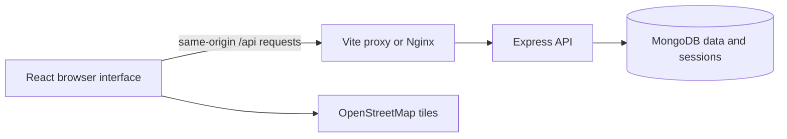
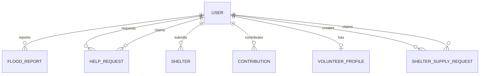

# FloodGuard

**Flood Emergency Reporting and Response System**

FloodGuard connects people affected by floods with volunteers, donors and shelter providers. Users can report flood conditions, request help and support local relief efforts. Administrators review submissions before key information becomes public.

This README describes the implementation on the branch containing it. Older branches may not contain every feature below.

**Project status:** Active development / local demonstration. The repository includes working community workflows and retained starter data. It does not claim to be a deployed emergency service or a bank payment processor.

**Quick start:** With Docker Desktop running, use `docker compose up --build --wait` from the repository root and open http://localhost:8080. See [Docker setup](#docker-setup) for database persistence and configuration. For Vite live reload or Atlas, follow [Local setup](#local-setup).

## Contents

- [Features](#features)
- [Technology and architecture](#technology-and-architecture)
- [Local setup](#local-setup)
- [Docker setup](#docker-setup)
- [Accounts and administration](#accounts-and-administration)
- [Pages and workflows](#pages-and-workflows)
- [Database design](#database-design)
- [API overview](#api-overview)
- [CRUD operations](#crud-operations)
- [Testing and CI](#testing-and-ci)
- [Troubleshooting](#troubleshooting)
- [Current scope and limitations](#current-scope-and-limitations)
- [Repository structure](#repository-structure)
- [Development and contributions](#development-and-contributions)
- [Support and security reporting](#support-and-security-reporting)
- [License and acknowledgements](#license-and-acknowledgements)

## Features

### Homepage and public information

- Interactive Sri Lanka map with approved, geolocated flood reports.
- Recent flood report cards with photos and a link to the full page.
- Two help request preview cards with a **See more** link.
- Approved shelter listings, occupancy and available spaces, alongside retained starter cards.
- Shelter supply shortages with taken/not-taken status.
- Total approved financial contributions in LKR, calculated from saved records.
- Volunteer/donor cards with saved profile photos or initials.
- English/Sinhala support, light/dark themes and responsive layouts.

### Community participation

- Register, sign in, sign out and view a personal profile.
- Submit flood reports with coordinates, descriptions, contact details and optional photos.
- Request help, including custom **Other help** details and optional photos.
- View personal help requests and contributions.
- Submit shelters with location, capacity, occupancy and facilities.
- Report shortages such as water, food, clothing and bedding.
- Eligible volunteers/donors can take available help and supply requests.
- Select multiple volunteer support areas and matching skills; update saved volunteer details.
- Submit financial/non-financial contributions, with an amount and receipt for financial support.
- Save, replace or remove an optional profile photo.

### Administration

- Dashboard counts and links to review pages.
- View details, report photos and contribution receipts.
- Approve or delete eligible pending flood reports, help requests, shelters and contributions.
- View new/existing volunteers and join or ignore new applications.
- Approved submissions leave their pending review queues and appear publicly.

## Technology and architecture

| Area | Technology |
| --- | --- |
| Frontend | React 19, Vite, Tailwind CSS; shared CSS for existing components |
| Map | Leaflet and OpenStreetMap tiles |
| Backend | Node.js, Express 5 |
| Database | MongoDB and Mongoose |
| Authentication | Server-side sessions, express-session and MongoDB session storage |
| Passwords | Salted scrypt hashes using Node.js crypto |
| Uploads | Multer; binary files stored in MongoDB documents |
| Checks | Node.js test runner, ESLint and Vite production build |
| Containers | Docker Compose, MongoDB, Node.js backend and Nginx frontend |
| CI | GitHub Actions |



Vite forwards `/api` to `http://localhost:5000` during development. In Docker, Nginx forwards those requests to the backend service. The backend explicitly uses the `floodguard` database.

## Local setup

### 1. Requirements

Install Git, Node.js 24 with npm, and either a local MongoDB server or access to MongoDB Atlas. Node.js 24 matches the major version in the project Dockerfiles. Internet access is needed for installation, Atlas and online map tiles.

### 2. Clone the repository

```powershell
git clone https://github.com/LakshikaYapa/Web-Application-Project.git
cd Web-Application-Project
```

Check out the intended branch before installing dependencies.

### 3. Configure and start the backend

```powershell
cd backend
npm.cmd ci
Copy-Item .env.example .env
```

If `.env` already exists, edit it instead of overwriting it. Set these values:

```dotenv
PORT=5000
MONGODB_URI=mongodb://127.0.0.1:27017/floodguard
SESSION_SECRET=replace-with-a-random-secret-of-at-least-32-characters
SESSION_COOKIE_SECURE=false
```

| Variable | Purpose |
| --- | --- |
| `PORT` | Backend port; Vite expects 5000 by default. |
| `MONGODB_URI` | Local MongoDB or Atlas connection string. |
| `SESSION_SECRET` | Random session-signing secret of at least 32 characters. |
| `SESSION_COOKIE_SECURE` | `false` for local HTTP; `true` for HTTPS deployments. |

Generate a random secret:

```powershell
node -e "console.log(require('node:crypto').randomBytes(48).toString('hex'))"
```

For Atlas, create a database user, allow your client IP under Network Access and supply the correct connection string. URL-encode special characters in URI credentials. Never commit the real `.env` file.

```powershell
npm.cmd run dev
```

The backend connects to MongoDB before listening for requests.

### 4. Start the frontend

Open a second terminal from the repository root:

```powershell
cd frontend
npm.cmd ci
npm.cmd run dev
```

Open the URL printed by Vite, normally **http://localhost:5173**. On macOS/Linux, use `npm` instead of `npm.cmd` and `cp .env.example .env` instead of `Copy-Item`.

### 5. Verify the connection

```powershell
Invoke-RestMethod http://localhost:5000/api/health
Invoke-RestMethod http://localhost:5000/api/ready
```

Health should return `success: true`. Readiness should also report `database: connected`.

## Docker setup

Start Docker Desktop with its Linux engine enabled. From the repository root:

```powershell
docker compose up --build --wait
docker compose ps
Invoke-RestMethod http://localhost:8080/api/ready
```

Open **http://localhost:8080**. Ports 8080 and 5000 must be available.

- The frontend waits for backend health, and the backend waits for MongoDB health.
- Compose uses its own MongoDB service, not the connection in `backend/.env`.
- Data persists in the `mongodb-data` named volume.
- MongoDB is internal to the Compose network; frontend/API ports bind to localhost.
- A root `.env` can override Compose's `SESSION_SECRET`; this is separate from `backend/.env`.
- This stack is for local development, not a production deployment template.

```powershell
docker compose logs --tail 100 frontend backend mongodb
docker compose down
```

`docker compose down` preserves database data. Adding `--volumes` deletes it. After source/dependency changes, rerun `docker compose up --build --wait`. Containers serve built files without frontend live reload.

## Accounts and administration

| Account role | Purpose |
| --- | --- |
| `help_seeker` | Community member requesting assistance |
| `volunteer` | Volunteer account, eligible for helper actions |
| `funder` | Donor account, eligible for helper actions |
| `admin` | Administrator, excluded from public registration |

Users can choose multiple public roles during registration. Sign in through the header, open the profile through its icon and sign out using **Logout**. Administrator accounts are directed to the admin dashboard.

A fresh database does not automatically contain an administrator. For initial local setup, register a normal account, then have the database owner assign the `admin` role to that specific account in `floodguard.users`. Preserve its password hash and change only the intended roles. Sign out and sign in again. Do not publish admin credentials or enable public admin registration.

The server uses MongoDB-backed sessions with HTTP-only, SameSite cookies and an eight-hour authentication lifetime. Protected actions check the current user's active status and roles. Owners are derived from the session, not submitted IDs.

## Pages and workflows

| Page | Path |
| --- | --- |
| Homepage | `/` |
| Flood reports and submission form | `/report-flood` |
| Public help requests and submission form | `/request-help` |
| My help requests | `/my-requests` |
| Shelter directory and supply requests | `/shelters` |
| Add a shelter | `/add-shelter` |
| Volunteer application | `/volunteer` |
| Donations | `/funder` |
| My contributions | `/my-contributions` |
| Profile and optional photo | `/profile` |
| Admin dashboard | `/admin` |
| Admin review pages | `/admin/help-requests`, `/admin/flood-reports`, `/admin/shelters`, `/admin/contributions`, `/admin/volunteers` |

### Flood reports

1. Sign in and enter the town, landmark, phone, situations and description.
2. Select a map location or enter latitude/longitude.
3. Optionally attach up to three JPG, PNG or WebP photos, up to 5 MB each.
4. Submit the report; it starts as `pending`.
5. An administrator approves or deletes the pending record.
6. Approved records appear publicly. Map markers require valid saved coordinates.

The map refreshes report data periodically and uses Sri Lanka coordinate bounds. Older records without coordinates can appear in the public list but are not assigned guessed map markers. Report dates are displayed because conditions may change.

### Help and shelter supply requests

Help requests collect the support type, town, location, phone, description and optional photos. **Other help** opens a custom field. Admin approval is required before public listing. Owners can view their submissions under My help requests.

Active volunteer/donor accounts can take eligible available requests. Users cannot claim their own requests. A conditional update prevents simultaneous claims; public cards show taken/not-taken status. Taking responsibility does not confirm dispatch or completed delivery.

Shelter shortages store a shelter name, town, phone, requested supplies and details. These shortage notices currently appear publicly without a separate admin approval stage. They also support helper claims.

### Contributions

Financial support requires a positive LKR amount and one JPG, PNG, WebP or PDF receipt up to 5 MB. Non-financial support does not require an amount or receipt. Contributions start as `pending_review`.

Amounts are stored as integer cents (`amountMinor`) with currency `LKR`. The public total sums **all approved financial contributions**, not just the latest cards. Public lists omit private contact details and receipt contents. Receipt files are restricted to authorized owner/admin endpoints.

### Profile photos and community cards

Use the profile icon, choose a JPG/PNG/WebP photo up to 5 MB and select **Save photo**. Users can replace or remove it. Public volunteer/donor cards use the saved photo, otherwise initials. Portraits align toward the top to reduce face cropping. Matching volunteer/donor names and towns are combined into one card with both labels.

## Database design



Each submitted record has one creator. Claimant references are optional, and each claimable record has at most one current claimant. One user has zero or one volunteer profile. These are MongoDB document references, not SQL tables.

| Model | Main data |
| --- | --- |
| `User` | Name, email, private contacts, password hash, roles, status, optional profile photo/version |
| `FloodReport` | Reporter reference, situations, town/location, coordinates, private phone, photos, status |
| `HelpRequest` | Requester reference, help type, location, description, photos, status, optional claimant |
| `Shelter` | Submitter reference, name/location, capacity, occupancy, facilities, private phone, status |
| `Contribution` | Contributor reference, support types, amount/currency, private receipt/contacts, status |
| `VolunteerProfile` | Unique user reference, town, support areas/skills and review status |
| `ShelterSupplyRequest` | Requester, shelter name/town, supplies, details, private phone and optional claimant |

Models record creation/update timestamps. Photos and receipts are embedded in their documents. Supply requests store shelter name/town as text rather than referencing a Shelter document.

## API overview

Paths are relative to the same-origin frontend. Protected actions use the session cookie. State-changing session/protected routes require `X-CSRF-Protection: 1`. Uploads use multipart form data.

| Method | Endpoint | Purpose |
| --- | --- | --- |
| GET | `/api/health`, `/api/ready` | Server and database checks |
| POST | `/api/auth/register`, `/api/auth/login` | Register / log in |
| GET | `/api/auth/me` | Current signed-in account |
| POST | `/api/auth/logout` | End the session |
| GET / POST | `/api/flood-reports` | Public approved list / authenticated submission |
| GET | `/api/flood-reports/map` | Approved coordinate-bearing reports |
| GET | `/api/flood-reports/:id/photos/:index` | Public approved report photo |
| GET / POST | `/api/help-requests` | Public approved list / authenticated submission |
| GET | `/api/help-requests/mine` | Owner's submissions |
| POST | `/api/help-requests/:id/claim` | Eligible helper claim |
| GET | `/api/help-requests/public/:id/photos/:index` | Public approved help photo |
| GET / POST | `/api/shelters` | Public approved list / authenticated submission |
| GET / POST | `/api/shelter-supplies` | Public shortages / authenticated submission |
| POST | `/api/shelter-supplies/:id/claim` | Eligible helper claim |
| GET | `/api/volunteers` | Joined active volunteer cards |
| GET / PUT | `/api/volunteers/me` | Read/update own application |
| GET / POST | `/api/contributions` | Recent approved entries / authenticated submission |
| GET | `/api/contributions/summary` | Financial total and contribution count |
| GET | `/api/contributions/mine` | Owner's contribution list |
| GET | `/api/contributions/:id/receipt` | Owner receipt; `?download=1` downloads |
| PUT / DELETE | `/api/profile/photo` | Save/remove own profile photo |
| GET | `/api/profile/:id/photo` | Available public helper photo or authorized own photo |
| GET | `/api/admin/dashboard` | Admin counts |
| GET | `/api/admin/{help-requests,flood-reports,shelters,contributions,volunteers}` | Admin review lists |
| POST | `/api/admin/{help-requests,flood-reports,shelters,contributions}/:id/approve` | Approve pending record |
| DELETE | `/api/admin/{help-requests,flood-reports,shelters,contributions}/:id` | Delete eligible pending record |
| POST | `/api/admin/volunteers/:id/join` or `/ignore` | Volunteer decision |

Braces in the table indicate alternative resource names, not literal URL characters. Paginated lists return `page` and `hasMore`. Common responses include 400 (invalid input), 401 (missing/expired session), 403 (permission/CSRF rejection), 404 (unavailable resource), 409 (state/claim conflict), 413 (oversized file) and 429 (rate limit).

See route code for exact behavior. [Backend notes](backend/README.md) contain additional examples, but some earlier implementation notes describe older steps.

## CRUD operations

| Operation | Implemented examples |
| --- | --- |
| **Create** | Registration; new reports, help requests, shelters, shortages and contributions |
| **Read** | Public/admin lists, details, map markers, personal submissions and profile data |
| **Update** | Admin approval, helper claims, volunteer skill changes and photo replacement |
| **Delete** | Admin deletion of eligible pending records and removal of a saved profile photo |

CRUD is used across the application. Not every resource permits unrestricted editing/deletion; ownership, role and status rules apply.

## Testing and CI

From the project root:

```powershell
cd backend
npm.cmd test
cd ../frontend
npm.cmd run lint
npm.cmd run build
```

Backend tests cover registration, sessions, validation, privacy, submissions, review actions, claims, public lists, donation totals and profile photos. Many HTTP tests mock database operations; they do not replace testing with a live browser and database.

[GitHub Actions CI](.github/workflows/ci.yml) defines Docker Compose smoke checks and frontend/backend checks. Push triggers include `main`, `dev` and `feature/**`; pull request triggers target `main` and `dev`.

### Manual verification checklist

1. Register/sign in, save a profile photo and reload the profile.
2. Submit a flood report with coordinates, approve it and check its public card/map popup.
3. Submit/approve a help request and claim it using a different eligible account.
4. Verify claim status and the two-card homepage help preview.
5. Submit/approve a shelter; report and claim a supply shortage.
6. Submit a volunteer application and join it as admin.
7. Submit/approve a test financial contribution and check the public total.
8. Confirm private receipt access, community photo cards and logout behavior.

## Troubleshooting

| Symptom | Checks |
| --- | --- |
| Backend will not start | MongoDB access, URI, secret length and port 5000 availability |
| Atlas connection error | Database-user credentials, permitted IP, cluster availability and network/DNS |
| Frontend cannot reach backend | Backend startup, `/api/ready` and target in `frontend/vite.config.js` |
| Local login session does not persist | `SESSION_COOKIE_SECURE=false` for HTTP; use a consistent frontend hostname/port |
| Data appears missing in Docker | Compose uses a separate MongoDB instance from `backend/.env` |
| Approved report leaves admin list | Pending queues intentionally omit approved records; check the public list |
| Report does not appear on map | Valid saved latitude/longitude and Sri Lanka bounds are required |
| Cannot take a request | Eligible active role, different requester, correct approval status and unclaimed record |
| Financial total is zero | Only approved financial LKR entries count; pending/non-financial entries do not |
| Map tiles missing | Internet access and external tile requests |
| Feature missing after branch switch | That branch must contain both frontend and backend changes |

## Current scope and limitations

- Retained shelter starter cards are sample information; their occupancy is not verified live data.
- Admin starter help/report examples are previews. Reviewing them updates browser session state rather than creating a real approved database record.
- Demonstration bank details are placeholders. This is not a payment gateway; receipt upload does not automatically verify a bank transfer.
- Claiming records responsibility, not completed delivery or emergency dispatch.
- Shortage notices do not currently have a separate administrator approval stage.
- Community cards merge matching normalized public names/towns rather than using a cross-list account identifier.
- Profile photos have top-aligned framing, not automatic face detection or a crop editor.
- File validation checks size, MIME type and basic signatures, not full decoding or malware scanning.
- Vite may warn about large JavaScript chunks; code splitting is a future improvement.
- Notifications, delivery tracking and administrator coordinate editing are future work, not current features.

## Repository structure

```text
.
|-- frontend/
|   |-- public/                 Static images/assets
|   |-- src/
|   |   |-- components/        Pages and reusable UI
|   |   |-- i18n/              Language helpers/translations
|   |   |-- App.jsx            Page selection and homepage
|   |   `-- index.css          Shared styles and Tailwind entry
|   |-- vite.config.js         Plugins and development API proxy
|   `-- nginx.conf             Container frontend/API routing
|-- backend/
|   |-- src/
|   |   |-- config/            Database/session configuration
|   |   |-- controllers/       Authentication/session logic
|   |   |-- models/            Mongoose models
|   |   |-- routes/            Public, owner and admin APIs
|   |   |-- validation/        Input/upload checks
|   |   |-- app.js             Express app factory
|   |   `-- server.js          Database/session startup
|   |-- test/                  Automated tests
|   `-- .env.example           Non-secret configuration template
|-- .github/workflows/ci.yml   CI workflow
|-- compose.yaml               Local three-service stack
`-- README.md                  Project guide
```

Use feature branches and review/test changes before merging into `dev`. Keep credentials, private user information and local report documents out of commits.

## Development and contributions

### Working on a change

1. Fetch the latest remote history and start from the agreed integration base. Work in a dedicated feature or fix branch.
2. Install dependencies with `npm ci` in both `frontend/` and `backend/`. These are separate applications; there is no root npm workspace or root test script.
3. Keep a change focused. Update both frontend and backend when changing an API contract, and update this guide if setup or behavior changes.
4. Add meaningful tests for changed validation, permissions, data access or workflows. Run the checks under [Testing and CI](#testing-and-ci).
5. Check `git diff` and stage only intended files. Never include `.env`, user uploads, real receipts or local report documents.
6. Open a pull request into `dev` describing the problem, resulting behavior and validation. Resolve conflicts without reverting newer features; review before merging.

Multiple feature branches in this repository share history, and some changes were cherry-picked. Compare their contents before merging; merging every old branch is not required to obtain the latest implementation.

### Available commands

Run these inside the specified directory:

| Directory | Command | Purpose |
| --- | --- | --- |
| `frontend` | `npm run dev` | Vite development server with live reload |
| `frontend` | `npm run build` | Compile production assets into `dist/` |
| `frontend` | `npm run preview` | Preview built frontend assets locally; not a production server |
| `frontend` | `npm run lint` | ESLint checks |
| `backend` | `npm run dev` | Development backend with nodemon |
| `backend` | `npm start` | Run the backend without nodemon |
| `backend` | `npm test` | Automated backend test suite |

Use the documented Vite development proxy or Docker/Nginx setup when testing the full application. Previewing frontend assets alone does not start the backend or MongoDB.

### Review checklist

- Test public access and the appropriate signed-in roles, including rejected actions.
- Check loading, empty and failure states as well as successful submissions.
- Verify both language modes and narrow/wide layouts for UI changes.
- Keep private fields out of public responses and do not trust client-supplied ownership or approval status.
- Update API examples and configuration instructions when they change.

## Support and security reporting

For reproducible bugs or feature requests, use the repository's [GitHub Issues](https://github.com/LakshikaYapa/Web-Application-Project/issues). Include the branch/commit, local or Docker setup, steps to reproduce, expected behavior and sanitized error output. A screenshot can help explain a UI issue.

Do not put passwords, connection strings, session cookies, personal contact details or private receipts into an issue or screenshot. For a security-sensitive finding, contact the repository owner privately through an established project contact instead of publishing exploit details in a public issue. This repository currently has no separate published security policy or dedicated reporting address.

Useful implementation references:

- [Backend configuration template](backend/.env.example)
- [Application routes and middleware](backend/src/app.js)
- [Backend route implementations](backend/src/routes)
- [Database models](backend/src/models)
- [Automated tests](backend/test)
- [CI workflow](.github/workflows/ci.yml)
- [Local container configuration](compose.yaml)

## License and acknowledgements

There is currently no repository-level `LICENSE` file. The backend package metadata declares `ISC`, but this README does not assign a new license to the whole application or its image assets. The project owner should confirm the intended repository license and add the appropriate license text.

Map data and tiles are provided by [OpenStreetMap contributors](https://www.openstreetmap.org/copyright), with attribution displayed on the map. FloodGuard uses open-source libraries including React, Vite, Tailwind CSS, Leaflet, Express, Mongoose and Multer; their respective licenses apply. The application also contains demonstration/AI-created imagery and externally sourced visual assets; asset origins and reuse permissions should be reviewed before publishing or redistributing them.
